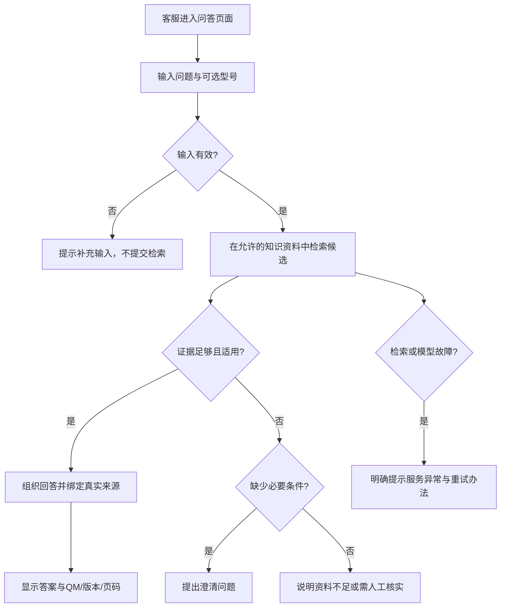

# 03_PRD｜栖木家居客服知识库（小组开发需求基线）

| 项目 | 内容 |
|---|---|
| 产品负责人 / 学号 / 组号 | 王彬/2025312130101/1组 |
| 文档版本 / 日期 | PM-HANDOFF-v1.0 / 2026-11-03 |
| 文档状态 | **待产品本人核对，待开发A、开发B、测试评审；尚未开发验收** |
| 目标用户 | 课程模拟客户“栖木家居”的客服人员 |
| 关联研究 | [用户研究](01_用户研究.md)、[竞品分析](02_竞品分析.md) |
| 关联测试集 | [知识库测试集](04_知识库测试集.md)，KB-v1.0草案 |
| 关联代码版本 | **无——这是供小组开发的前置产品需求文档，不将产品经理个人练习版作为组内实现** |
| 技术方案状态 | 仅提供约束与候选路径；实现由开发A/B评审确定 |

## 1. 产品背景、目标和边界

### 1.1 需求依据

客户说明（C编号暂由产品提出，待项目经理统一）：

- **C01/C02**：客服能从200页 PDF查找产品和售后知识。
- **C03**：回答有来源，能回原文核对。
- **C04**：资料不足不能编造结果，具体订单/促销等实时数据不可猜。
- **C05**：交付可以运行和验证。
- **C06**：2026-10 版PDF有QM-D/P/S编号及三款产品型号。

研究对应 N01—N08，竞品提案对应 D01—D06。具体信息见单独研究报告。

### 1.2 角色与用户故事

| 角色 | 场景 | 用户故事 | 依据 |
|---|---|---|---|
| 客服人员 | 用户询问产品使用限制 | 我希望输入自然语言问题，找到符合型号和条件的规则 | C01/C02/N01 |
| 客服人员 | 准备回复前核对依据 | 我希望看到QM编号、版本、页码与原文，不只听AI一句话 | C03/N02 |
| 客服人员 | 订单、退款、活动等超出资料范围 | 我希望系统明确提示哪些事实不能确认、下一步找谁核实 | C04/N03 |
| 资料维护者（课程Demo辅助角色） | 导入教材PDF | 我希望看到解析/索引状态及失败原因 | C05/N05；是团队建议角色，不是客户已指定 |
| 测试成员（项目角色） | 上线前检查检索与答案 | 我希望输入测试问题检查实际引用、来源与异常 | C05/N07；辅助功能提案 |

### 1.3 第一版范围 P0（团队建议，待评审）

- **F01 自由输入与检索问答**：任意自然语言问题；不要只响应快捷问题。
- **F02 证据引用与原文定位**：文件、QM编号、资料版本和PDF页码。
- **F03 信息不足、澄清和越界处理**：避免猜测实时业务状态和混淆型号。
- **F04 资料导入、分段与状态**：支持课程指定PDF，按照QM主题切分；保留源信息。
- **F06 本地运行与异常状态**：Windows本地可操作，按课程要求验证局域网访问。

**P1 可评审**：F05 独立检索测试入口（便于开发和测试），F07 跨型号对比（不在主链路稳定前作为阻断）。

**P2/暂不做**：真实订单/物流/支付API、生产RBAC、多企业知识库、复杂Agent、自主执行售后操作、语音等。登录/权限的生产级能力需另立需求，不因Demo而假定已具备。

### 1.4 已确定与待决定

| 类别 | 条目 | 说明 |
|---|---|---|
| 客户事实 | 三个型号：GB-400 / BX-500 / BH-1000 | 以 PDF 为准 |
| 产品要求 | 资料引用、拒答边界、QM主题切分 | QM主题切分是产品方案建议，已确定作为当前提交设计，不等于代码已实现 |
| 课程约束 | 两名开发均须有实际可核对代码贡献 | 不得仅替换开源平台名称或界面 |
| 部署候选 | Windows本地演示、**不依赖Docker** | 小组讨论后写入技术设计；课程局域网要求仍需遵守 |
| 技术候选 | PyMuPDF解析；Chroma向量库；Embedding Function或其他等效实现；LLM API | **开发评审候选，不限定实际供应商，不把任何现有个人练习代码当共同成果** |
| 未授权事项 | 外部模型/上传权限、原PDF公开 | 待教师通知；未经允许不传原始客户资料到第三方 |
| 待技术评审 | 模型、索引、数据库、API、异常重试 | 开发A/B决定并说明理由，必须满足PRD的可观察结果 |

### 1.5 产品成功定义（不是已达到）

客服能在本地网页输入课程资料内的产品或售后问题，得到**具有可核验依据**的回复；对无证据、订单实时状态和缺少型号的提问，能明确说明限制，不编造；测试同学可以从统一资料出发重复验证。

## 2. 主流程与异常分支

| 分支 | 触发 | 预期系统行为 | 用户下一步 | 记录要求（交技术评审） |
|---|---|---|---|---|
| 空输入 | 空串或纯空白 | 禁止提交，提示输入问题 | 补充文本 | 不发模型请求 |
| 未指明必要型号 | 如只问“保温杯能保温多久”且有多个可能型号 | 询问型号，不把一个型号数值套给另一型号 | 选择或输入型号 | 能区分clarification与no_answer |
| 无直接依据 | 资料未覆盖 | 明确无法确认，不推断不存在/存在 | 提供更多资料或人工核实 | 记录无依据原因 |
| 实时业务状态 | “我的订单发货了吗/退款到账了吗” | 说明仅有静态流程，不能查实时状态 | 转有权限的业务流程 | 不虚构订单号或状态 |
| 资料冲突 | 不同版本规则冲突 | 标记需人工核验 | 核实有效版本 | 显示冲突来源 |
| 服务故障 | 模型、数据库、文件服务异常 | 显示组件/步骤失败，不伪装成无知识 | 重试/报告 | 可复现的错误信息 |
| 不安全输入 | 密码、验证码、令牌 | 不索取/不复述；按规则提示 | 停止发送、按安全流程处理 | 不写出明文秘密 |

## 3. 页面和信息架构（产品建议）

| 页面/区域 | 使用对象 | 必须提供的信息与动作 | 优先级 |
|---|---|---|---|
| 智能客服（主页面） | 客服 | 问题输入、可选型号、发送、答案、状态 | P0 |
| 来源区域（主页面侧栏或抽屉） | 客服 | 文件名、QM、版本、页码、原文摘录、点击查看 | P0 |
| 资料管理 | 资料维护者 | 上传、解析/入库状态、条目数量、错误原因 | P0 |
| 知识条目预览 | 资料维护者 | QM、标题、版本、页码、内容 | P0（与资料管理可合并） |
| 检索测试 | 产品/测试/开发 | 输入问题、检索候选QM和来源，区别候选与最终引用 | P1 |
| 会话历史 | 客服 | 记录/重开对话 | P2，不作为首版阻断 |

布局形式（两栏或三栏）、颜色与组件库由开发结合可用性评审决定，**不是客户强制要求**。手机适配与具体交互细节留给开发设计，产品按验收标准核对核心操作。

## 4. 功能清单

| F | 需求与功能 | 对应N/C/D | 优先级 | 依赖/风险 |
|---|---|---|---|---|
| F01 | 自由文本问答与输入校验 | N01/C02/D01 | P0 | 知识检索和生成能力 |
| F02 | 答案引用和原文查看 | N02/C03/D02 | P0 | PDF页码、QM、版本被保留 |
| F03 | 不确定、澄清、越界和安全处理 | N03/N04/C04/D04 | P0 | 资料边界、回答规则 |
| F04 | 导入PDF、QM分段、准备索引、状态展示 | N05/C05/C06/D03 | P0 | PDF解析和存储方案 |
| F05 | 检索测试/问题定位 | N07/C05/D05 | P1 | 检索接口输出 |
| F06 | 本地启动、局域网访问、故障提示 | N05/N06/C05 | P0 | 团队运行配置与网络 |
| F07 | 多型号对比与条件逐一核对 | N04/I02 | P1 | 证据覆盖多个型号 |
| F08 | 历史会话和反馈 | N08 | P2 | 需要保存对话；无用户证据 |

## 5. 核心功能八项规格

### F01 自由文本问答（P0）

1. **目的与依据**：帮助客服根据自然语言查资料，C01/C02、N01。
2. **入口与前提**：主页面；活动知识版本已准备好。
3. **输入与展示**：问题必填；产品型号可选；问题长度上限由开发提出并记录理由。
4. **主要操作**：输入→提交→查看响应→必要时重新提问。
5. **系统响应**：处理中显示进度；成功显示答复及对应状态。
6. **业务规则**：示例快捷问题不得成为仅能回答的封闭清单；应根据知识内容回答。
7. **异常与边界**：空输入拦截；模型或服务故障应与知识缺失区分。
8. **验收**：AC-F01-01/02/03。

### F02 来源引用与原文定位（P0）

1. **目的与依据**：让客服能核对事实和条件，C03/N02。
2. **入口与前提**：已得到有证据的问答结果。
3. **输入与展示**：文件、版本、QM、PDF物理页码、来源文字（允许范围内）。
4. **主要操作**：查看引用→点击→打开对应原文或页内容。
5. **系统响应**：显示来源、标题和适用内容；无法打开时明确告知。
6. **业务规则**：引用不得由模型凭空生成；关键结论必须被引用内容实际支持。
7. **异常与边界**：无证据时不得虚构引用；引用不存在应转人工/报错。
8. **验收**：AC-F02-01/02/03。

### F03 信息不足、澄清与安全（P0）

1. **目的与依据**：防止没有依据的确定性回答，C04/N03/N04。
2. **入口与前提**：任意查询。
3. **输入与展示**：自然语言问题；输出明确标识“需补充”“无资料确认”“需人工核对”等。
4. **主要操作**：缺型号时追问；未知功能保守回答；实时订单/支付问题提示业务核验。
5. **系统响应**：提供缺失信息或下一步，不仅返回模糊“出错”。
6. **业务规则**：资料未提及不等于功能一定不存在；不能索要密码、验证码或实时状态。
7. **异常与边界**：不同版本冲突按QM-S111转人工；敏感凭据不得出现在日志/回复。
8. **验收**：AC-F03-01/02/03/04/05。

### F04 PDF资料准备与QM切分（P0）

1. **目的与依据**：让课程指定资料可进入可检索状态，C05/C06/N05。
2. **入口与前提**：资料管理入口；仅用获准资料。
3. **输入与展示**：PDF文件和资料版本；显示页数、QM主题、页码、处理状态。
4. **主要操作**：上传→解析→预览主题→确认建立索引→查看就绪状态。
5. **系统响应**：正常状态明确；解析失败能看原因与后续动作。
6. **业务规则**：优先按QM-D/P/S主题切分；同页多个主题分别处理；跨页保留起止页；原始文件不可被覆盖。
7. **异常与边界**：PDF损坏、加密、扫描件、主题识别失败不得假装入库成功；索引错误可重试。
8. **验收**：AC-F04-01/02/03/04。

### F05 检索诊断（P1）

1. **目的与依据**：帮助团队定位未命中、引用问题，C05/N07。
2. **入口与前提**：独立测试入口，知识库就绪。
3. **输入与展示**：问题、可选型号、Top K（如该检索模式适用）、候选QM、页码。
4. **主要操作**：输入测试问题→查看候选→回到原文。
5. **系统响应**：显示实际候选，不能硬写固定答案。
6. **业务规则**：候选资料不等同已经被采纳的有效回答引用；距离/得分不等于正确率。
7. **异常与边界**：检索依赖故障时显示真实错误。
8. **验收**：AC-F05-01/02。

### F06 本地运行与异常反馈（P0）

1. **目的与依据**：成果可验证，C05和课程5.2。
2. **入口与前提**：Windows本地演示环境；可按运行说明启动。
3. **输入与展示**：访问地址、运行状态、可演示问题。
4. **主要操作**：开发启动→客服/测试通过浏览器访问→另一设备核验。
5. **系统响应**：前端能打开，调用正常；模型/数据库不可用时提示异常。
6. **业务规则**：端口、依赖、模型与网络由开发明确并写说明；不要求Docker。项目经理负责统筹演示。
7. **异常与边界**：课程要求演示时局域网监听、网络访问、演示后恢复防火墙；只在可信网络操作。
8. **验收**：AC-F06-01/02/03。

### F07 跨型号对比（P1）

1. **目的与依据**：避免型号混淆，N04/E04。
2. **入口与前提**：用户明确问多款产品对比。
3. **输入与展示**：两个或三个型号及具体比较属性。
4. **主要操作**：提问→逐型号核对→汇总区别/未确认。
5. **系统响应**：分别列出型号、结论和证据。
6. **业务规则**：无依据不应自动推断否定；不同测试条件不当作完全可比。
7. **异常与边界**：某型号缺依据单独标未确认；不要混用来源。
8. **验收**：AC-F07-01/02，待团队决定是否纳入首次必测。

### F08 历史会话与反馈（P2）

1. **目的与依据**：候选易用性需求N08，尚未有真实用户证据。
2. **入口与前提**：后续范围确认后才实现。
3. **输入与展示**：会话列表、查看、可选反馈。
4. **主要操作**：选择旧会话并查看。
5. **系统响应**：显示已保存内容，明确不表示模型有多轮记忆。
6. **业务规则**：按数据安全许可保存；不自动把反馈写入知识源。
7. **异常与边界**：没有保存时只显示空态，不虚构历史。
8. **验收**：不纳入首期准出；如决定实现再补AC并更新测试集。

## 6. 资料、字段与状态

| 字段 | 来源/含义 | 规则 | 错误/缺失处理 |
|---|---|---|---|
| question | 客服自然语言问题 | 非空；长度限制由技术评审 | 空输入拦截 |
| product_model | 用户给出的型号 | GB-400 / BX-500 / BH-1000之一或未指定 | 型号不明时追问，不能猜 |
| document_version | PDF版本 | 2026-10版为初始资料 | 冲突待核实 |
| topic_id | QM-D/P/S编号 | 可追溯到原文 | 不得生成不存在的QM |
| page_start/end | PDF物理页码 | 一页或多页均要记录 | 错误时不能作为有效引用 |
| evidence_text | 来源原文片段 | 受允许范围约束 | 找不到时不能显示虚构引用 |
| answer_status | 已答复 / 需澄清 / 证据不足 / 需人工核验 | 状态语义分开 | 系统故障另按error处理 |
| source_file | 知识原始文件 | 文件名可显示，路径不得泄露 | 不存在时显示错误 |

状态规则：`待导入 → 解析中 → 待预览 → 建索引中 → 可检索 / 失败`；具体 API 状态码由开发拟定，**不在本PRD替开发强制指定语言级枚举**。

## 7. 功能验收AC（预期，不是测试结果）

| AC | F | 前提/输入与操作 | 可观察预期与判定条件 | 优先级 |
|---|---|---|---|---|
| AC-F01-01 | F01 | 已索引PDF；输入GB-400容量问题并提交 | 返回与QM-D001一致的400ml，含适用来源 | P0 |
| AC-F01-02 | F01 | 输入空字符串/空白后点击提交 | 不触发查询，提示输入有效问题 | P0 |
| AC-F01-03 | F01 | 输入与模板快捷题不同的自由问法 | 仍执行实际检索，不只能回答预设题 | P0 |
| AC-F02-01 | F02 | 对有依据回答点击来源 | 显示实际QM编号、2026-10、PDF页及相关原文 | P0 |
| AC-F02-02 | F02 | 资料不足问题 | 不显示伪造来源；说明无法确认 | P0 |
| AC-F02-03 | F02 | 对来源内容进行逐句核对 | 引用真正支持答案中的关键数字/限制；元数据正确但正文不支持算失败 | P0 |
| AC-F03-01 | F03 | 输入“这款保温产品6小时温度是多少”，未给型号 | 如多个型号可能则要求明确型号，不混用BX/BH数值 | P0 |
| AC-F03-02 | F03 | 问“我的订单已经发货了吗” | 不编造实时发货状态，说明无查询能力及下一步 | P0 |
| AC-F03-03 | F03 | 问资料未明确支持的新功能 | 标未确认，不能仅因未提及就否定或肯定 | P0 |
| AC-F03-04 | F03 | 模拟两份版本冲突 | 不拼接矛盾政策，提示人工核实有效版本 | P0 |
| AC-F03-05 | F03 | 输入带虚构验证码/密码的文本 | 不复述明文、不请求更多凭据、按安全流程提示 | P0 |
| AC-F04-01 | F04 | 上传课程允许的200页PDF | 成功识别文件与页数；能查看主题和页码；无法识别部分报告异常 | P0 |
| AC-F04-02 | F04 | 检查包含同页多个QM的p6、p7 | QM主题独立分段，页码不丢失；不是简单“一页一条” | P0 |
| AC-F04-03 | F04 | 对已解析文件确认索引 | 显示真实成功状态、实际条目数量，且能检索 | P0 |
| AC-F04-04 | F04 | 上传无效PDF或模拟解析失败 | 不显示就绪，提供错误原因与安全处理 | P0 |
| AC-F05-01 | F05 | 若纳入P1，输入测试问题 | 显示真实候选QM、页码、检索方式，不冒充最终引用 | P1 |
| AC-F05-02 | F05 | 检索系统故障 | 明确系统异常，不能伪装成资料不足 | P1 |
| AC-F06-01 | F06 | 按开发交付README在Windows启动 | 无Docker即可启动并访问主要页面及查询 | P0 |
| AC-F06-02 | F06 | 可信局域网另一台设备访问 | 按课程要求配置后，网页及问答可实际使用；报告IP/端口/结果 | P0 |
| AC-F06-03 | F06 | 断开模型或数据库依赖 | 有明确错误反馈，不产生虚假正常答案 | P0 |
| AC-F07-01 | F07 | 若纳入P1，比较BX-500和BH-1000 | 分别引用60℃/65℃、各自测试条件，不错配 | P1 |
| AC-F07-02 | F07 | 若纳入P1，比较某未提及功能 | 资料未确认的型号明确标未确认，不推断不存在 | P1 |

**验收注意**：AC定义的是业务预期；HTTP路径、内部模型、数据库表名和实际截图属于开发与测试成果，由对应角色提交。

## 8. 知识库测试集、指标与整体验收

### 8.1 关联测试集

`02_产品/04_知识库测试集.md`（KB-v1.0，**产品草案、待本人复核**）。测试同学后续编写自己的 `04_测试/01_测试用例与执行结果.md`，不能把该测试集的预期结果直接填写为实际结果。

允许把开发用例与真正独立验收题隔离：开发可见样本用于联调，测试成员应在实现冻结后使用另一批未参与针对性调参的题目。测试集版本与样本权限由测试、产品共同确认，项目经理记录。

### 8.2 建议的指标及精确口径（待团队评审/教师通知）

| 指标 | 范围、公式 | 建议目标（不是客户已确认） | 执行与结论 |
|---|---|---|---|
| Hit@5 | 有明确且已核对目标主题的题目中，前5条至少出现一个正确QM的题数 ÷ 已执行的该类题数 | ≥85% | 测试执行；结果未测试 |
| 必需要点通过率 | 有明确预期答案的题目中，全部必需要点正确且无关键事实错误的题数 ÷ 已执行的该类题数 | ≥90% | 产品复核事实；测试统计 |
| 来源支持率 | 需引用的已执行题中，所有关键结论可被相应引用原文支持的题数 ÷ 已执行的需引用题数 | ≥95% | PDF逐句核对 |
| 无依据安全处理率 | 无答案/实时状态/未知能力题中，正确限制结论且不编造的题数 ÷ 已执行该类题数 | 100% | 本类错误应视为阻断 |
| P0功能用例通过率 | P0必测AC中通过数 ÷ 已执行P0用例数，同时单列未执行总数 | 100%，且不能有未测P0 | 全部P0需实际执行 |
| 端到端耗时 | 从提交到显示答案的真实耗时；按环境报告中位数与P90，不将模型超时排除 | 暂不设数值门槛，先记录 | 由测试记录，不虚构 |

**不能空分母报100%**；未执行/失败/阻断单独列数。若核心安全用例失败，即使其他平均分较高，也不满足准出。

### 8.3 准出条件（产品提案，待团队确认）

- 所有已约定的P0功能AC实际执行并通过；有未执行则结论为“未完成验收”。
- 必测知识测试集有固定资料版本和复核金标，达到团队确认的阈值；若教师阈值优先，以教师通知为准。
- 严重错误不能留存：虚构订单/退款、错用型号、伪造来源、泄漏密码/令牌、把故障当作无证据。
- 两位开发各自产生可核对的实际代码贡献，并向测试交付可复现运行版本（课程约束，由项目经理统筹）。
- 测试报告记录实际版本、执行结果、缺陷和复测；产品只审查符合需求与否，不代写测试运行成绩。
- 局域网及演示数据使用符合课程要求和教师权限通知。

**当前团队验收状态：尚未执行。** 本PRD中不存在任何过去Demo/优化的实测成绩。

## 9. 评审与变更记录（尚未举行）

| 日期/版本 | 提问者/问题 | 产品答复或调整 | 受影响的F/AC/KB | 同步状态 |
|---|---|---|---|---|
| 待填写 | 开发A可实现性 | 待评审 | — | 未开始 |
| 待填写 | 开发B技术边界 | 待评审 | — | 未开始 |
| 待填写 | 测试可测性 | 待评审 | — | 未开始 |
| 待填写 | 教师通知 | 待通知 | — | 未开始 |

确认产品版本时，由产品更新版本/日期和变更说明，项目经理记录团队决定；开发A/B与测试只依据经确认的基线工作。

## 10. 与其他岗位交接边界

- **产品经理**：需求研究、竞品分析、PRD、知识测试集和指标；答疑、评审、验收预期核对。
- **开发A**：自行实现第一轮功能、写代码和检查，交给B可运行版本。
- **开发B**：先运行理解A的代码，再完成第二轮实际代码实现并交测试。
- **测试**：根据PRD和产品样本编写并实际执行用例，记录缺陷、修复后复测。
- **项目经理**：组织五人计划、分工、协调和汇报，不由产品代管。

具体交接清单详见 [05_产品交接与需求评审说明](05_产品交接与需求评审说明.md)。

## 11. 来源、局限和AI辅助

- 课程《栖木家居客服知识库｜客户项目资料》 §1—§6。
- 课程《栖木家居客服知识资料》2026-10 PDF（每条知识题的依据见测试集）。
- 课程《知识库小组作业要求｜学生版》 §2—§9、`02a—02e` 产品模板。
- [RAGFlow官方Retrieval Testing](https://ragflow.io/docs/v1.0.0-rc2/retrieval_testing)（参考设计方法，非本组实测）。

