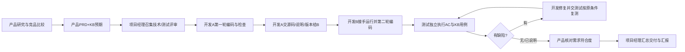

# 05_产品交接与需求评审说明（产品经理→开发A/B、测试）

版本：PM-HANDOFF-v1.0｜状态：待项目经理组织小组评审  
**这是补充工作说明，不代替项目经理的计划与分工，也不代替开发和测试各自的作业模板。**

## 1. 四方职责边界

| 角色 | 接收产品输入 | 对本阶段应交付什么 | 不该由谁代做 |
|---|---|---|---|
| **产品经理（我）** | 客户说明、PDF、研究、竞品资料 | 用户研究、竞品分析、PRD、知识库测试集、AC和指标；接受需求问题并修订 | 不负责写程序、不填写测试PASS、不编造访谈 |
| 开发A | 已评审PRD、PDF与知识元数据要求 | 第一轮可运行代码、解析/资料处理等约定模块、代码检查、运行说明、向B交接 | 产品不能替开发A编写交付源码 |
| 开发B | PRD、A的源码与交接、接口/数据约定 | 先独立运行并理解A版本，再实现问答/检索/前端等约定模块、回归、自检、交测试 | 不得仅配置服务；必须有可定位代码贡献 |
| 测试 | PRD功能AC、KB题单、开发B可运行版本 | 独立编写用例并执行、真实截图/日志、缺陷/复测、指标统计和测试结论 | 产品不能代写执行结果 |
| 项目经理（另设） | 全部角色成果与待确认事项 | 发起评审、统筹节点/依赖、交接、最终汇报PPT与提交 | 产品不代替项目经理统筹全组 |

> 第一轮具体开发范围由A/B共同评估工作量后确认，上表是推荐切分，不是教师规定某项技术必须由某个人写。

## 2. 产品需求评审前准备

产品经理将以下文件交给项目经理安排开发A、开发B、测试共同阅读：

- `02_产品/01_用户研究.md`：N编号及待验证假设。
- `02_产品/02_竞品分析.md`：D提案、官方来源、哪些尚未实操。
- `02_产品/03_PRD.md`：F01—F08、AC-Fxx、P0/P1。
- `02_产品/04_知识库测试集.md`：KB-v1.0，全部未执行。
- 教师统一客户说明与 PDF：仅在允许的使用范围内提供。

## 3. 评审需要确认的十个问题（各角色反馈）

| # | 待确认问题 | 主要反馈人 | 产出 |
|---|---|---|---|
| R01 | 第一版P0是否过多/是否少了核心任务？ | 开发A/B、测试 | 产品确定F清单 |
| R02 | PDF同页多QM、跨页、页码能否稳定处理？ | 开发A | F04实现策略与异常 |
| R03 | 客服回答如何保证每条引用来自真实来源？ | 开发B/测试 | F02验收和可追溯方案 |
| R04 | 无证据、缺型号、实时状态、服务异常如何区分？ | 开发B/测试 | F03/F06状态映射 |
| R05 | 哪些配置或服务向外传递客户资料？是否获得许可？ | 项目经理/开发B | 数据边界决定，未授权不能出站 |
| R06 | 采用何种技术栈、数据库、模型、API？ | 开发A+B | 技术方案与理由，产品只验用户可见结果 |
| R07 | 两位开发各自代码贡献如何确认？ | 开发A+B/项目经理 | 各自任务与Git记录方案 |
| R08 | 哪些KB样本有明确正确原文？哪些需复核？ | 产品/测试 | 冻结KB版本和金标 |
| R09 | 指标分母、目标是否合理、怎样计算？ | 产品/测试 | PRD 8.2阈值确认 |
| R10 | 如何在Windows、局域网实际验收？ | 开发A/B/测试 | 启动与演示检查计划 |

## 4. 按课程流程的交接路径

**每一步之前的说明均为计划状态，非已完成记录。**

### 交接给开发A的需求输入（不是开发任务命令）

- 可解析的资料范围：教师提供的200页PDF，按QM编号主题组织。
- 必须产出给后续开发使用的知识元数据：文件、资料版本、QM编号、起止PDF页、知识文本和产品型号（如果有）。
- 可观察结果：F04全部P0 AC及至少一题精确来源定位。
- A需自行交付：代码、实际运行方式、测试/检查记录、问题清单、版本标识。

### 交接给开发B的需求输入

- 已评审F01/F02/F03/F06及相关AC；在A可运行代码上接力。
- 与产品共识：优先让自由问题得到可核对的证据，而非只写若干固定问答；回答缺依据时要拒答或澄清；用户可见状态与系统错误分开。
- B需自行交付：代码及调用关系、从A接手的运行验证、接口/页面和实际自测、测试可运行版本。

### 交接给测试的需求输入

- P0 AC清单、KB-v1.0预期题单及来源页码；未确认题目先反馈产品。
- 测试需按自己的模板补充前置条件、操作、实际结果、截图、问题与原条件复测。
- 测试应准备独立问题，不能将开发调试用例的命中率自动当最终独立验收结果。
- 发现需求有歧义时退回产品，不自行改预期或改标准答案。

## 5. 评审与变更登记（待真实填写）

| 日期 | 提出角色 | 问题/影响F/AC/KB | 产品决策/理由 | 小组确认 | 同步版本 |
|---|---|---|---|---|---|
| 【待填】 | 【待填】 | 【待填】 | 【待填】 | 【待填】 | 【待填】 |

所有修改需要产品更新PRD和KB的版本、日期与影响范围；项目经理记录分工和节点变化。开发及测试应按确认版本执行。

## 6. 产品经理在验收阶段只需承担的工作

- 解释题目真正问的是什么以及原始 PDF 哪条规则支持。
- 检查测试上报的错误是否违反产品预期；必要时修正有歧义的需求并登记变更。
- 判断修复是否满足原始客户目标，但**不自行制造测试通过记录**。
- 向项目经理提供产品部分的汇报内容：研究、竞品取舍、P0范围、AC和指标、已确认的产品变更；不代替其制作全部项目管理成果。

## 7. 当前状态

- 产品文件：**草案已形成，待本人核对、评审**。
- 真实访谈与竞品平台实际操作：**未记录为已完成**。
- 小组A/B开发：**未记录为已开始/已完成**。
- 小组测试：**未执行**。
- 个人先前练习成果：**不作为本包实现、回归、产品验收或他人贡献依据**。
